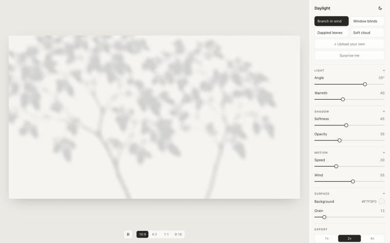

# Daylight

Animated light-and-shadow backgrounds for the web. Branches swaying in the wind, sun through window blinds, dappled leaves, soft cloud shadows. Pick a look, tune it, then export a PNG or copy one snippet that runs on any website.

Free and open source. No accounts, no server: everything runs in your browser.



## Features

- **Four presets:** Branch in wind, Window blinds, Dappled leaves, Soft cloud. Switching crossfades smoothly.
- **Surprise me:** a random look, kept within ranges that always work.
- **Controls:** light angle, warmth, softness, opacity, speed, wind, background color and grain. Every change shows up instantly.
- **Aspect ratios:** 16:9, 4:3, 1:1 and 9:16.
- **Your own shadow:** upload an image and Daylight turns it into a shadow, with three motion styles:
  - **Sway** swings from where the shape grows (an edge it touches, or a stem like tree trunks).
  - **Drift** repeats the image and floats it slowly.
  - **Still** holds it in place with a gentle flutter.
- **PNG export** at 1x, 2x or 4x (up to 5120 × 2880 for 16:9). It captures the exact frame on screen.
- **Copy code:** one self-contained snippet with the animation and images inside. Paste it into any site's HTML; there are no files to host.
- Light and dark interface, keyboard support, and reduced-motion support (the animation starts paused).

## Getting the best results from your own image

Use a high-contrast image: the shape in **white** on a solid **black** background. White becomes shadow; black stays as light.

- Keep the background plain and the edges clean.
- Shapes touching an edge, or with a thin stem, sway from that point. Patterns that fill the frame drift.
- PNG, JPG, WebP or SVG, up to 25 MB. Around 2000 px wide works well.

Photos and dark-on-light drawings work too: Daylight detects which side is shadow, and **Threshold** and **Invert** let you fine-tune. Your image never leaves your browser. The last upload is remembered in this browser only.

## Using Copy code

Copy code gives you a `<div>` and a `<script>`. Paste both where you want the background:

- The div starts at your chosen aspect ratio. Resize it with your own CSS.
- Anything you put inside the div sits on top of the light.
- The snippet is about 90–210 KB, depending on the look.
- It pauses when scrolled out of view or when the tab is hidden, and shows a still frame for visitors who prefer reduced motion. Without WebGL 2 it shows the plain background color.

Some site builders strip `<script>` tags from pasted HTML. If the snippet shows only its background color, check that your builder allows custom code.

## Running it locally

Requires [Node.js](https://nodejs.org/) 20.19 or newer.

```bash
npm install
npm run dev
```

Then open http://localhost:5173.

To make a production build in `dist/`:

```bash
npm run build
```

`dist/` is a static site, so any static host can serve it. Both `dev` and `build` first build the embeddable player (`npm run player`), which Copy code pastes into snippets. Restart the dev server after changing the renderer or shaders, so snippets pick up the change.

## How it works

Daylight is a single WebGL 2 fragment shader: a small program the GPU runs for every pixel, every frame.

1. **Masks.** Each look is a grayscale image (`public/masks/`) where white is shadow and black is light.
2. **Fit and light.** The mask is cropped to fill the frame, then stretched and leaned by the light angle, like a shadow lengthening as the sun drops.
3. **Wind.** A slow noise model on the CPU rotates or nudges the whole shadow, with occasional gusts. A small per-pixel flutter grows toward the leaf tips.
4. **Softness.** The mask is blurred by sampling a spiral of points from smaller, pre-shrunk copies of the texture (mipmaps). That stays smooth and fast.
5. **Color.** The background darkens toward a cool shadow tint, while lit areas take the light's warmth. The math happens in linear light, which is how real light mixes. Then a touch of animated film grain is added.

Presets are plain data in `src/presets.ts`. Two scene slots in the shader let any two looks crossfade.

### Project structure

```
public/masks/        shadow images (white = shadow)
src/
  shader/            vertex and fragment shaders
  renderer.ts        WebGL setup, scenes, crossfades, PNG rendering
  presets.ts         the four presets and Surprise me ranges
  wind.ts            wind and gust model
  state.ts           settings store
  custom/            upload: image to mask, shape detection, storage
  export.ts          PNG export
  snippet.ts         Copy code snippet builder
  player.ts          embeddable player used by snippets
  ui/                sidebar, controls, bottom bar, dialogs
```

## Browser support

Recent Chrome, Edge, Firefox and Safari, on desktop and mobile. WebGL 2 is required.

## License

[MIT](LICENSE). The shadow images in `public/masks/` are part of this project and covered by the same license.
